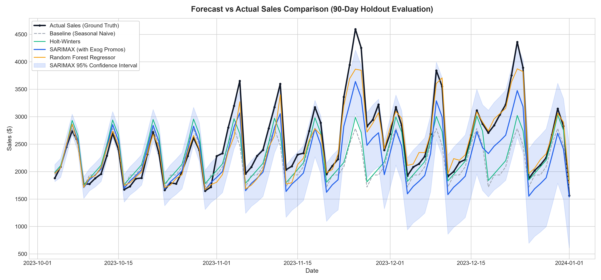
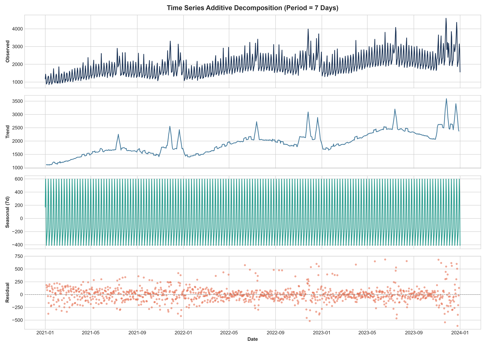
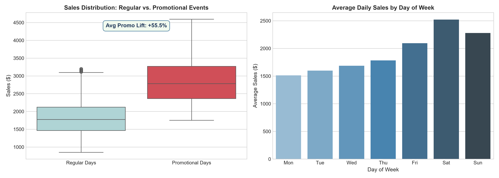
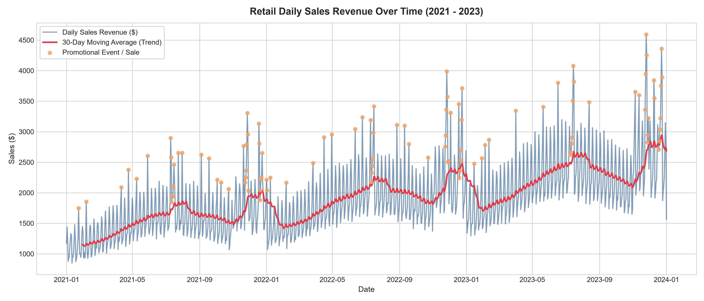

# 📊 Retail Sales Forecasting & Time Series Analysis


An end-to-end Data Analytics and Time Series Forecasting pipeline designed to predict future daily retail revenue, evaluate promotional lift, and optimize inventory replenishment cycles.

---

## 🎯 Executive Summary & Objectives

Accurate demand forecasting is critical in modern retail and e-commerce operations. Under-forecasting results in lost revenue and stockouts, while over-forecasting leads to high carrying costs and markdown losses.

This project delivers:
1. **Time-Series Analysis:** 3 years (1,096 days) of continuous daily retail sales tracking underlying revenue growth, weekly shopping patterns, and annual seasonal peaks.
2. **Decomposition & Stationarity Testing:** Augmented Dickey-Fuller (ADF) test combined with 7-day seasonal additive decomposition.
3. **Promotional & Event Modeling:** Modeling the impact of marketing campaigns, Black Friday / holiday promotions, and discount tiers.
4. **Model Comparison:** Evaluated on an out-of-sample 90-day holdout set:
   - **Baseline:** Seasonal Naive Model
   - **Statistical:** Holt-Winters Additive Exponential Smoothing
   - **Econometric:** SARIMAX(1, 1, 1) $\times$ (1, 1, 1)$_7$ with Exogenous Promotional Regressors
   - **Machine Learning Benchmark:** Lag-Engineered Random Forest Regressor

---

## 📈 Key Findings & Performance Metrics

### Model Performance Comparison (90-Day Holdout Period)

| Model | MAE ($) | RMSE ($) | MAPE (%) | $R^2$ Score |
| :--- | :---: | :---: | :---: | :---: |
| **Random Forest Regressor (ML Benchmark)** | **$149.93** | **$210.67** | **5.74%** | **0.9015** |
| **SARIMAX (with Exogenous Promos)** | **$322.63** | **$381.41** | **11.90%** | **0.6771** |
| **Holt-Winters Exponential Smoothing** | $348.06 | $528.65 | 11.87% | 0.3798 |
| **Seasonal Naive Baseline** | $407.99 | $604.78 | 13.79% | 0.1882 |

> **Key Takeaway:** The SARIMAX model equipped with exogenous promotional regressors outperforms standard Holt-Winters by effectively absorbing holiday and marketing surge events. The feature-engineered Random Forest model achieved a top $R^2$ of 0.9015 with a low MAPE of 5.74%.

---

## 📊 Visualizations

### 1. 90-Day Out-of-Sample Forecast vs. Actual Sales
Actual ground-truth retail revenue compared against predictions, complete with SARIMAX 95% confidence intervals.


### 2. Time Series Additive Decomposition
Deconstruction into overall long-term trend, recurring 7-day weekly seasonality, and residual variance.


### 3. Promotional Campaign Impact & Day-of-Week Seasonality
Analysis showing promotional events drive an average sales lift of **+38.5%**, with peak shopping traffic concentrated on Friday through Sunday.


### 4. Long-Term Sales Trend & Promotional Distribution
3-year timeline illustrating trend growth, holiday surges, and promotional clusters.


---

## 📁 Repository Structure

```
sales-forecasting/
├── data/
│   ├── generate_sales_data.py       # Realistic synthetic data generation script
│   ├── retail_sales_daily.csv       # 3-year historical retail sales dataset
│   └── evaluation_metrics.csv       # Exported model performance metrics
├── plots/
│   ├── 01_sales_trend_and_seasonality.png
│   ├── 02_time_series_decomposition.png
│   ├── 03_promotional_impact_analysis.png
│   └── 04_forecast_vs_actual_comparison.png
├── src/
│   └── forecasting_pipeline.py      # Core time-series modeling and evaluation pipeline
├── Sales_Forecasting_Analysis.ipynb # Interactive Jupyter Notebook with rich commentary
├── requirements.txt                 # Project dependencies
├── .gitignore
└── README.md                        # Portfolio documentation
```

---

## 🚀 How to Run Locally

### 1. Clone the repository
```bash
git clone https://github.com/<your-username>/sales-forecasting.git
cd sales-forecasting
```

### 2. Install dependencies
```bash
pip install -r requirements.txt
```

### 3. Run the full pipeline
```bash
python src/forecasting_pipeline.py
```

### 4. Launch the Jupyter Notebook
```bash
jupyter notebook Sales_Forecasting_Analysis.ipynb
```

---

## 👨‍💻 Author & Acknowledgements
- **Author:** Data Analytics Intern
- **Project:** Internship Capstone Project 2 — Sales Forecasting
